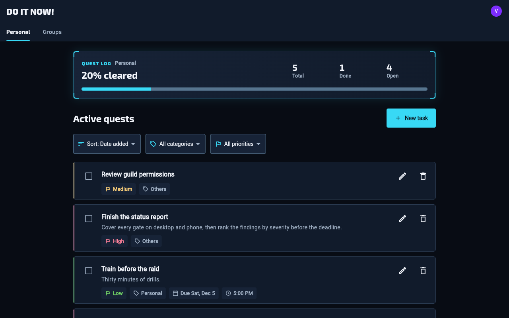
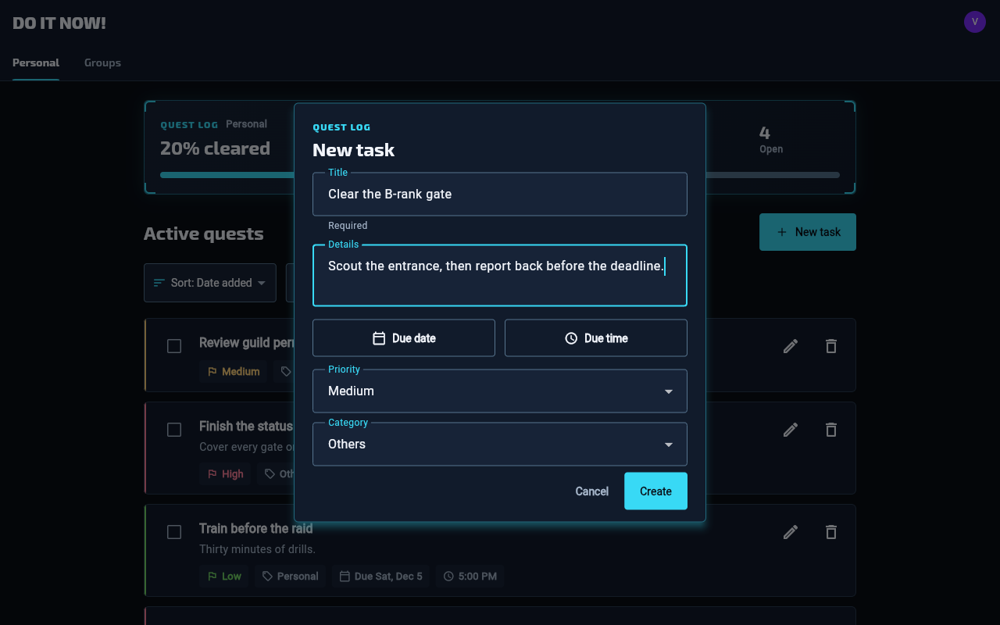
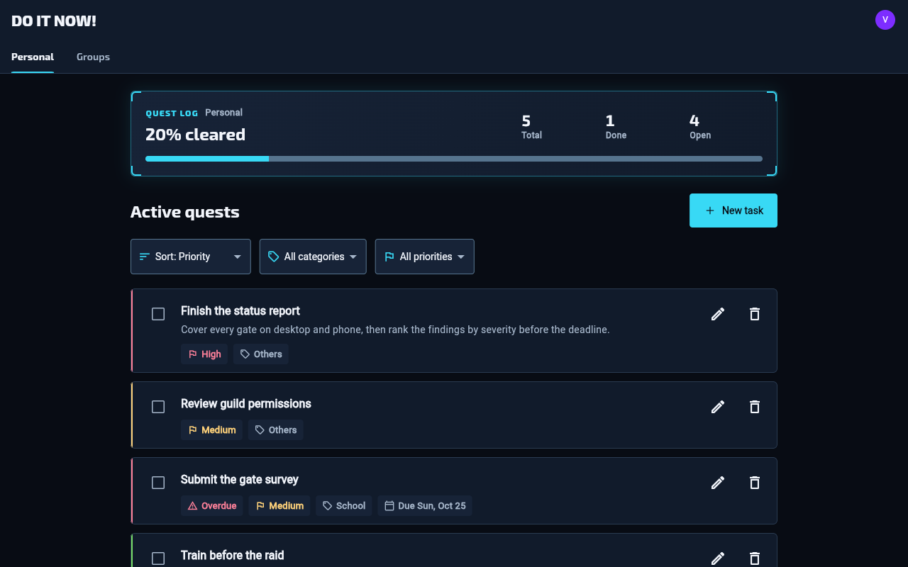
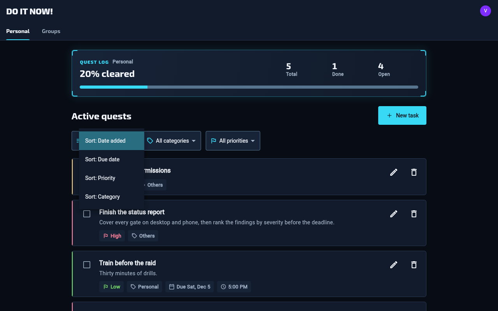

# Do It Now!

A Flutter task-management app with a game HUD-inspired interface. Tasks support due dates, due times, priorities, categories, completion state, sorting, filtering, undo deletion, and Firestore persistence.

## Tech Stack

- **Flutter and Dart**: cross-platform UI and application logic.
- **Firebase Core**: initializes the Firebase project for supported platforms.
- **Firebase Authentication**: email/password accounts and optional Google sign-in.
- **Cloud Firestore**: stores task documents and streams changes in real time.
- **Exo 2**: the heading typeface (`AppFonts.display` in `lib/theme/app_theme.dart`), bundled under `assets/fonts` with its SIL Open Font License.

Firestore was chosen instead of an in-memory list because tasks must survive browser refreshes and app restarts. Its realtime stream keeps the task list synchronized after create, edit, completion, and delete operations. Authentication and `ownerId` prevent users from accessing another user's tasks.

## Firebase Setup

The project is configured for the Firebase project in `lib/firebase_options.dart` and currently supports Web, Windows, and macOS. The platform client API keys are supplied at build time from a local, ignored `.env` file.

Before running the app:

1. Open the Firebase Console and select the configured project.
2. Create or enable **Cloud Firestore**.
3. Enable **Authentication -> Sign-in method -> Email/Password**. Enable **Google** if Google sign-in is required.
4. Add the deployed app's domain to **Authentication -> Settings -> Authorized domains**.
5. Review the password reset and email change templates under **Authentication -> Templates**.
6. Publish the rules in `firestore.rules`.

From a machine with Node.js and the Firebase CLI installed and authenticated, deploy the rules to the intended project with:

```powershell
firebase deploy --only firestore:rules --project doitnow-c26f9
```

The rules file is intentionally committed. Firestore rules are access-control configuration, not secret credentials. Do not commit Firebase service-account private keys or Admin SDK credentials.

## Run Locally

### Requirements

- Flutter SDK compatible with Dart `^3.13.2`
- A configured Firebase project
- Chrome for Web, or a supported desktop Flutter platform
- Node.js and the Firebase CLI for deploying rules or running the local emulators

From the project directory:

```powershell
Copy-Item .env.example .env
# Fill the three FIREBASE_*_API_KEY values in .env from Firebase Console.
flutter pub get
flutter analyze
flutter test
flutter run -d chrome --dart-define-from-file=.env
```

The `.env` file is ignored by Git and is not a Flutter asset. Flutter reads it only when `--dart-define-from-file=.env` is passed. Use the same flag for `flutter build` and supported-platform integration tests, for example `flutter build web --dart-define-from-file=.env`. The app reports a configuration error if a platform key is missing or still contains the template placeholder. Firebase web client keys are still present in compiled web output; keep service-account keys and other server secrets out of the app entirely. If you regenerate `lib/firebase_options.dart` with FlutterFire CLI, restore its environment-variable API-key bindings before committing.

For Windows desktop:

```powershell
flutter run -d windows --dart-define-from-file=.env
```

The app uses Firebase Authentication for login and stores the current UID, email, and display name in the owner's `users/{uid}` Firestore profile document. Firebase Authentication is authoritative for account credentials and profile identity; Firestore mirrors the active values for app data. Passwords are never written to Firestore.

Registration creates an email/password account in Firebase Authentication, then stores its UID, email, and display name in `users/{uid}`. Login delegates password verification to Firebase Authentication. Its SDK restores the browser session after refresh; `AuthGate` shows the dashboard only while a user is authenticated. Sign-out clears the Firebase session and the app navigator so protected screens cannot remain open. Firestore rules enforce ownership using the authenticated UID.

### Profile and password flows

- Display name updates are written to Firebase Authentication and mirrored to Firestore.
- Email changes require the current password and reauthentication. Firebase sends a verification link; the current address stays active until the new address is verified. The app reloads Firebase Authentication and synchronizes the verified email to Firestore on startup, app resume, and when the profile page opens or resumes.
- Firebase Authentication enforces email uniqueness. The profile displays a specific duplicate-email error.
- Direct password changes require the current password, a new password, and confirmation. Passwords are managed only by Firebase Authentication.
- Password recovery uses Firebase's hosted email action handler. Links use single-use, expiring action codes; Firebase applies the new password when the user completes the hosted flow. The app does not receive or store reset codes.
- The reset screen uses neutral feedback so it does not reveal whether an email is registered.
- Google-only accounts can update their display name here; their email and password are managed through Google. Password-provider accounts can request a verified email change and change their password in the app.
- Unsaved profile edits require an explicit Stay or Discard choice before Back or logout. Profile operations show progress and then success or error feedback.

For an email change, check the **new** address, including its spam/junk folder. The old address remains active until the link is opened. If the app confirms the request but no message arrives, check **Authentication -> Templates** in Firebase Console and the project's [email sending limits](https://firebase.google.com/docs/auth/limits). When using the Authentication emulator, no real email is delivered; its verification URL appears in the terminal running `firebase emulators:start`.

To return a completed password reset or email verification to the deployed app, build with its root URL as the continue URL:

```powershell
flutter run -d chrome --dart-define-from-file=.env --dart-define=FIREBASE_AUTH_CONTINUE_URL=https://YOUR_DEPLOYED_APP_DOMAIN/
```

Replace the example with the actual deployed app URL and add that domain to Firebase Authentication's **Authorized domains**. If this setting is omitted, Firebase's default hosted action handler still processes the email action, but it may not return the user to the app afterward. No custom email action handler is currently required.

### Local Firebase emulators

`firebase.json` configures the Authentication and Firestore emulators. Start them with:

```powershell
firebase emulators:start --only auth,firestore --project doitnow-c26f9 --export-on-exit=.firebase-emulator-data
```

Run the app against emulators in a separate terminal:

```powershell
flutter run -d chrome --dart-define-from-file=.env --dart-define=USE_FIREBASE_EMULATORS=true
```

The emulator flag is opt-in. Without it, the app uses the Firebase project configured by FlutterFire. To restore saved emulator data after a restart, add `--import=.firebase-emulator-data` to the start command; the export flag writes changes back when the emulators stop.

## Data Model

Each document in the Firestore `tasks` collection contains:

```text
ownerId   string       authenticated Firebase user ID
title     string       required task title
details   string       optional details
createdAt timestamp    creation timestamp
dueDate   timestamp?   optional due date
dueTime   int?         minutes after midnight
priority  string       low, medium, or high
category  string       school, personal, or others
isDone    boolean      completion state
```

## CRUD Data Operations

The app uses `FirestoreTaskRepository` in `lib/services/task_repository.dart` rather than REST endpoints.

### Read tasks in real time

```dart
final stream = FirebaseFirestore.instance
		.collection('tasks')
		.where('ownerId', isEqualTo: FirebaseAuth.instance.currentUser!.uid)
		.snapshots();
```

The repository maps each document into a `Task` and sorts the stream result for display.

### Create a task

```dart
final task = Task(
	title: 'Review notes',
	details: 'Prepare for the quiz',
	createdAt: DateTime.now(),
	priority: TaskPriority.medium,
	category: TaskCategory.school,
);

await repository.createTask(task);
```

The repository adds the authenticated user's `ownerId` and creates a Firestore document ID.

### Update a task

```dart
task.isDone = true;
task.priority = TaskPriority.high;
await repository.updateTask(task);
```

The same update operation is used for editing fields and marking a task complete.

### Delete a task

```dart
await repository.deleteTask(task);
```

The UI first asks for confirmation, hides the task temporarily, and provides a five-second Undo action before calling this operation.

## UI Features

- Create and edit task title, details, due date, due time, priority, and category. Enter creates or saves the task, and closing an edited form by clicking outside it asks before discarding the changes.
- Delete confirmation with delayed deletion and Undo. The Undo bar closes when the deletion commits.
- Checkbox completion with strikethrough and visual status styling, plus a brief "Quest cleared" notice when a task is completed.
- Overdue tasks are flagged. A due date with no time counts as on time until that day ends.
- Sort by date added, due date, priority, or category. Open tasks stay above completed ones under every sort.
- Filter by priority or category, with **Clear filters** when nothing matches.
- Dark System-window theme inspired by hunter and dungeon stories: cyan glow, framed panels, and Exo 2 headings. Motion respects the device's reduced-motion setting.
- Red high-priority, yellow medium-priority, and green low-priority indicators.

## Screenshots

### Main Task Dashboard



### Create or Edit Task



### Task Priority and Category States



### Sorting and Filtering



## Testing

Run all checks with:

```powershell
flutter analyze
flutter test
```

Widget tests use fake repositories and account services, so they do not require network access or a live Firestore database. They cover account settings as well as task serialization, editing, deletion confirmation, Undo, completion updates, filtering, and tag ordering.

Run the Firebase-backed account and Firestore-rules checks in isolated emulators:

```powershell
firebase emulators:exec --only auth,firestore --project doitnow-c26f9 "node --test scripts/account_compliance.test.mjs"
```

These checks create throwaway accounts in the local Authentication emulator, read one-time email action codes from its local endpoint, and verify changes against Authentication and the local Firestore rules. They do not use real accounts or production data. The Flutter `integration_test` suite is also available for native targets using `flutter test integration_test/account_compliance_test.dart -d windows --dart-define-from-file=.env` while the emulators run; Flutter's integration runner does not support Chrome.

## Activity 3: User-Based Access Control and Collaborative Lists

Activity 3 keeps personal tasks private and adds small collaborative lists. Firebase Authentication supplies the identity used by Firestore rules. A user's UID, rather than an email address, is the stable ownership and membership key.

### Firestore schema

The existing `users/{uid}` and personal `tasks/{taskId}` collections remain in use. Personal task documents keep the fields listed above; `ownerId` must equal the signed-in UID. Collaborative data uses this structure:

```text
collaborativeLists/{listId}
  ownerId       string       immutable UID of the list owner
  name          string       list name
  memberIds     string[]     owner and current member UIDs; maximum 20 entries
  createdAt     timestamp
  updatedAt     timestamp

collaborativeLists/{listId}/tasks/{taskId}
  ownerId       string       UID of the user who created this task
  title         string       required task title
  details       string       optional details
  createdAt     timestamp
  dueDate       timestamp?   optional due date
  dueTime       int?         minutes after midnight
  priority      string       low, medium, or high
  category      string       school, personal, or others
  isDone        boolean      completion state

publicProfiles/{uid}
  displayName   string       name other accounts can see; maximum 256 characters
```

Each account has a deterministic default collaborative list whose ID is the account's UID, named "My group" until its owner renames it. Initialization is idempotent and must not overwrite an existing list. An account can create more lists, each with the ID `<20 random letters and digits>_<owner UID>`. Rules accept only these two forms, so no account can claim the ID of another account's default list. Lists cannot be deleted. `memberIds` stores UIDs only; profile names and email addresses are not copied into list or task documents. `publicProfiles/{uid}` holds only the display name, kept apart from `users/{uid}` because rules cannot hide that document's email field. The app writes it on registration and on each profile sync, which also creates it for existing accounts the next time they open the app. Shared task `ownerId` records its creator and cannot be changed. A removed member, or one who leaves, loses access because rules check current membership on each request. Tasks they created stay in the list.

### Access matrix

| Data or operation | Signed-out user | Personal task owner | Current collaborative-list member | List owner | Non-member |
| --- | --- | --- | --- | --- | --- |
| Read or change `users/{uid}` profile | Denied | Own profile only | Own profile only | Own profile only | Denied |
| Read `publicProfiles/{uid}` by UID | Denied | Allowed | Allowed | Allowed | Allowed; listing is denied |
| Change `publicProfiles/{uid}` | Denied | Own only | Own only | Own only | Own only |
| Read or change `tasks/{taskId}` | Denied | Own tasks only | Own personal tasks only | Own personal tasks only | Denied |
| Read a collaborative list and its tasks | Denied | If a current member | Allowed | Allowed | Denied, including guessed IDs |
| Create, update, or delete a collaborative task | Denied | If a current member | Allowed; creator `ownerId` stays immutable | Allowed; creator `ownerId` stays immutable | Denied |
| Create a collaborative list | Denied | Allowed, as its owner | Allowed, as its owner | Allowed, as its owner | Allowed, as its owner |
| Change list name or membership | Denied | Denied unless also owner | May only remove themselves | Owner only; UID membership is updated directly under Firestore rules | Denied |

The dashboard has **Personal** and **Groups** tabs. The **Groups** tab lists each group the account owns or has joined, offers **New group**, and shows the account's UID with a **Copy UID** action. Opening a group shows its tasks with the name of each task's creator. The owner also gets **Manage members** and **Rename group**, and any other member gets **Leave group** and a disabled **Manage members** whose tooltip says only the owner can use it. On a narrow display these actions move into a menu in the group's header.

Only the list owner may add or remove other members, and the owner cannot be removed or leave. A member can only remove themselves, and rules reject any other change that member makes to the list. The owner enters the other account's UID, which that account can copy from its **Groups** tab or read in **Profile -> Account details**. **Manage members** lists members by display name and can remove any of them. A UID with no public profile is shown as **Unknown account** with the UID, because a well-formed UID is not checked against existing accounts when it is added; this covers a mistyped UID and an account that has not opened the app since public profiles were added. Membership is a direct Firestore update to `memberIds`; rules require the caller to own the list, reject duplicate UIDs, and cap the list at 20 UIDs including the owner. There is no email lookup, no verified-email requirement for invitations, and no Cloud Function to deploy. Because UIDs are opaque, the invited account must share its UID with the owner first.

### Emulator setup and checks

The Authentication and Firestore emulators are configured in `firebase.json`. Install Node.js alongside the Firebase CLI and a Java runtime for Firestore emulation. The root `package.json` contains only local emulator test tooling and is not deployed. Install its dependencies, then start both emulators:

```powershell
npm ci
firebase emulators:start --only auth,firestore --project doitnow-c26f9 --import=.firebase-emulator-data --export-on-exit=.firebase-emulator-data
```

Run the app with `flutter run -d chrome --dart-define-from-file=.env --dart-define=USE_FIREBASE_EMULATORS=true`. This connects Auth and Firestore to their local emulators. Emulator builds use a placeholder API key and keep the session in memory, so refreshing the page signs out. This is deliberate: on web the SDK validates a saved session during `Firebase.initializeApp`, before the emulator can be connected, which would otherwise leave Auth on the real project. A fresh emulator run can omit `--import`; stop the emulators normally to write the export. Emulator data is local and does not represent production records. The emulator UI is available at `http://127.0.0.1:4000` when enabled; use its Authentication and Firestore views to inspect test accounts, list membership, and task documents.

For automated checks with a fresh emulator instance (stop any existing emulators first):

```powershell
firebase emulators:exec --only auth,firestore --project doitnow-c26f9 "node --test scripts/account_compliance.test.mjs scripts/ubac_emulator.test.mjs"
flutter analyze
flutter test
flutter build web --dart-define-from-file=.env
```

The UBAC suite uses synthetic emulator accounts and direct requests to check personal-task isolation, shared-task permissions, owner-only UID membership changes, duplicate and capacity limits, and access revocation. Widget tests exercise tab and group switching, UID invitations, and account/form cleanup. These checks do not replace a deployed two-account demonstration or a browser refresh check.

To check backend restart persistence independently, use a fresh export directory containing only synthetic data:

```powershell
firebase emulators:exec --only auth,firestore --project doitnow-c26f9 --export-on-exit=.firebase-emulator-data/ubac-restart "node scripts/ubac_persistence.mjs seed"
firebase emulators:exec --only auth,firestore --project doitnow-c26f9 --import=.firebase-emulator-data/ubac-restart "node scripts/ubac_persistence.mjs verify"
```

The second command verifies login and restored list membership and task data after a separate emulator process starts. Do not run the seed against an imported copy of the same fixture.

### Deploying on the Spark plan

The app and its Firestore rules can be deployed without Cloud Functions. Invitations are UID-based and write directly to `memberIds`, so the project can stay on Firebase's free Spark plan subject to its Firestore quotas. Deploy only the rules and the Flutter build, rules first, because the app writes `publicProfiles` and needs rules that allow it:

```powershell
firebase deploy --only firestore:rules --project doitnow-c26f9
flutter build web --dart-define-from-file=.env
```

Host the built web app on Firebase Hosting or another static host. Do not run `firebase deploy --only functions`; there is no Functions source or configuration left in this project. The trade-off is that there is no email-to-UID lookup, so each person must share the UID shown on their **Groups** tab with the group owner before being added.

### Demo and repository history

Prepare two accounts by registering through the app. Add three to five personal tasks to each account. Sign in as the second account, copy the UID from the **Groups** tab, then sign in as the first account, open its group on the **Groups** tab, and add that UID under **Manage members**. Show the app with each account signed in and use Firebase Console or the emulator UI as the database viewer to show the separate personal task owners, the shared list's `memberIds`, and its nested tasks. Keep passwords out of this repository and screenshots. A useful demonstration also shows that a non-member cannot read the shared list by using a guessed document ID.

The Activity 3 working branch is `act3-ubac`, created from `main` at `45b1e7d`. The authentication work was already present in the branch's history: merging `auth` reported that it was already up to date, so this activity did not create another auth merge or produce merge conflicts. The repository also contains the earlier historical merge commit `6f65f96` (`Merge PR #1 dev`). This records the history observed for this activity; it does not claim a new pull request or merge.
