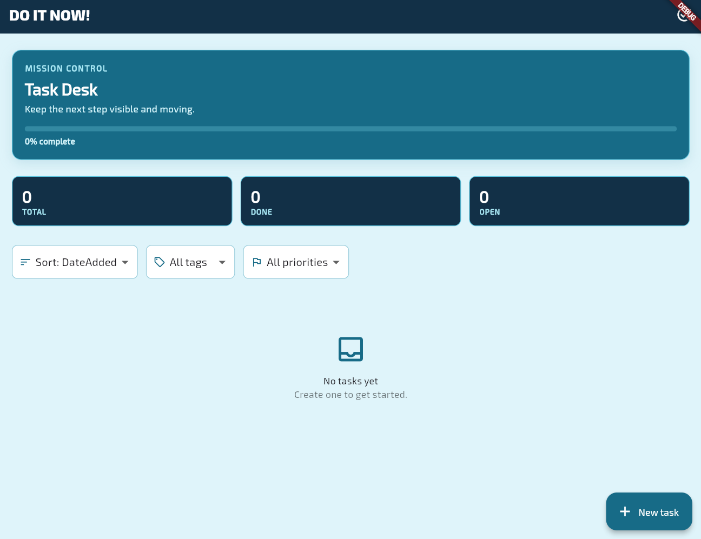
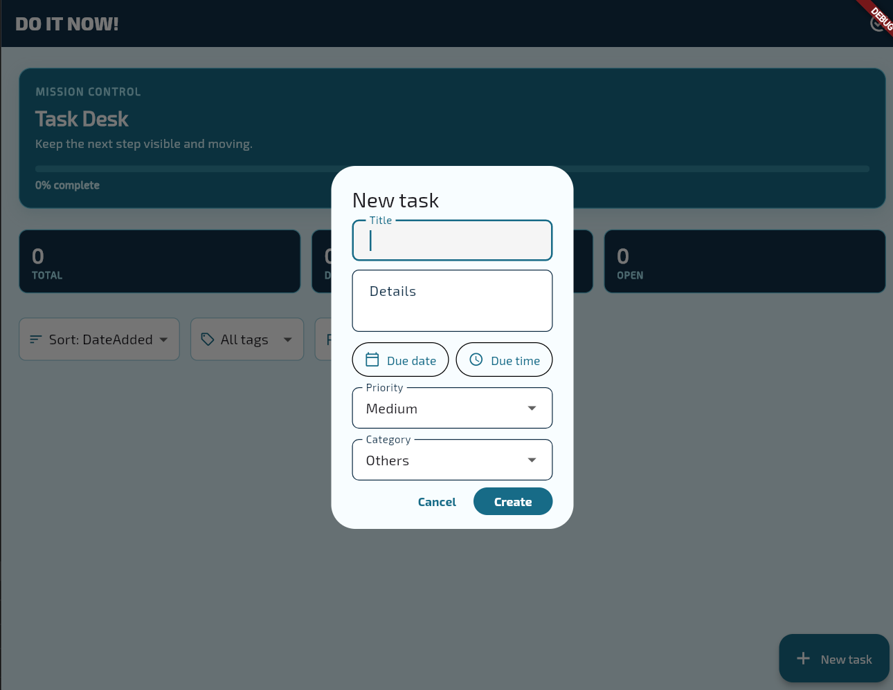
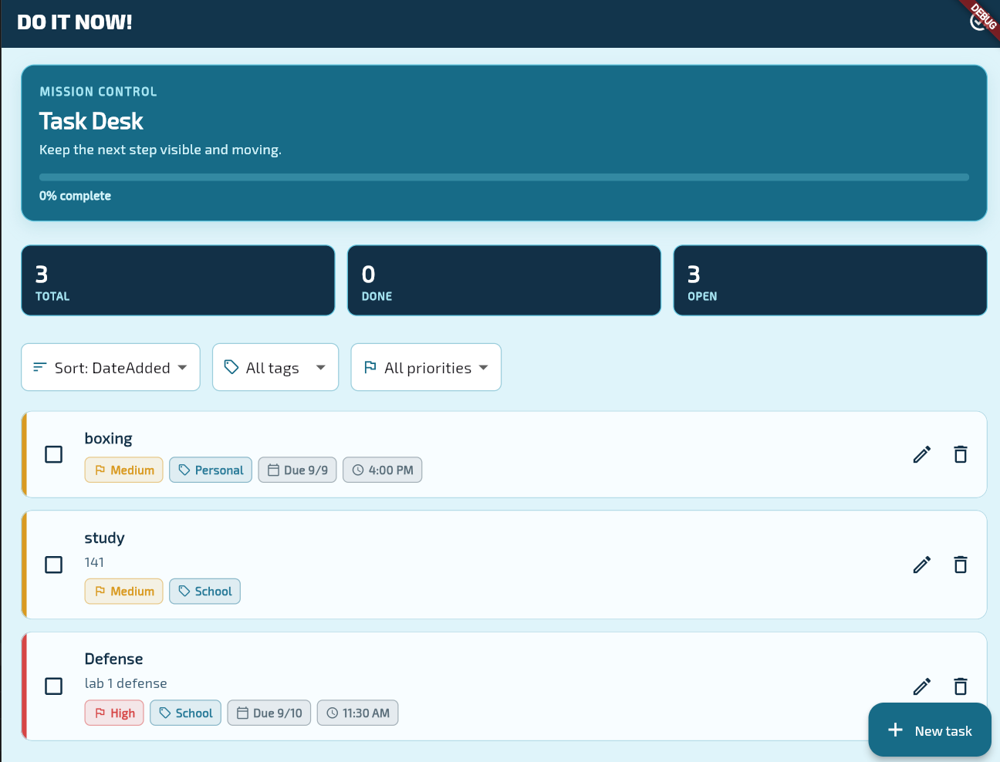
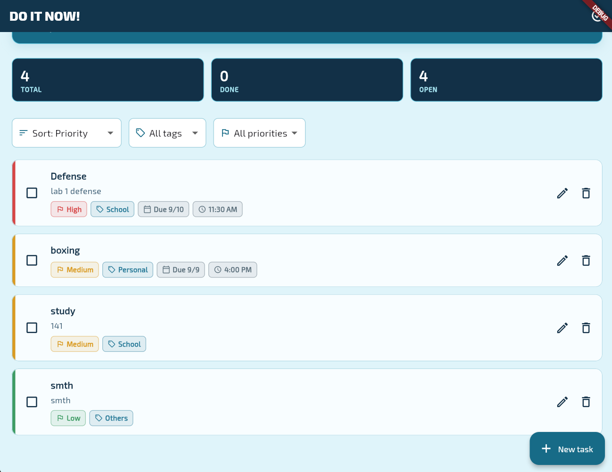

# Do It Now!

A Flutter task-management app with a game HUD-inspired interface. Tasks support due dates, due times, priorities, categories, completion state, sorting, filtering, undo deletion, and Firestore persistence.

## Tech Stack

- **Flutter and Dart**: cross-platform UI and application logic.
- **Firebase Core**: initializes the Firebase project for supported platforms.
- **Firebase Authentication**: email/password accounts and optional Google sign-in.
- **Cloud Firestore**: stores task documents and streams changes in real time.
- **Google Fonts**: provides the Exo 2 typeface used throughout the HUD interface.

Firestore was chosen instead of an in-memory list because tasks must survive browser refreshes and app restarts. Its realtime stream keeps the task list synchronized after create, edit, completion, and delete operations. Authentication and `ownerId` prevent users from accessing another user's tasks.

## Firebase Setup

The project is configured for the Firebase project in `lib/firebase_options.dart` and currently supports Web, Windows, and macOS. The platform client API keys are supplied at build time from a local, ignored `.env` file.

Before running the app:

1. Open the Firebase Console and select the configured project.
2. Create or enable **Cloud Firestore**.
3. Enable **Authentication -> Sign-in method -> Email/Password**. Enable **Google** if Google sign-in is required.
4. Add the deployed app's domain to **Authentication -> Settings -> Authorized domains**.
5. Review the password reset and email change templates under **Authentication -> Templates**.
6. Publish the rules in `firestore.rules`.

From a machine with Node.js and the Firebase CLI installed and authenticated, deploy the rules to the intended project with:

```powershell
firebase deploy --only firestore:rules --project doitnow-c26f9
```

The rules file is intentionally committed. Firestore rules are access-control configuration, not secret credentials. Do not commit Firebase service-account private keys or Admin SDK credentials.

## Run Locally

### Requirements

- Flutter SDK compatible with Dart `^3.13.2`
- A configured Firebase project
- Chrome for Web, or a supported desktop Flutter platform
- Node.js and the Firebase CLI for deploying rules or running the local emulators

From the project directory:

```powershell
Copy-Item .env.example .env
# Fill the three FIREBASE_*_API_KEY values in .env from Firebase Console.
flutter pub get
flutter analyze
flutter test
flutter run -d chrome --dart-define-from-file=.env
```

The `.env` file is ignored by Git and is not a Flutter asset. Flutter reads it only when `--dart-define-from-file=.env` is passed. Use the same flag for `flutter build` and supported-platform integration tests, for example `flutter build web --dart-define-from-file=.env`. The app reports a configuration error if a platform key is missing or still contains the template placeholder. Firebase web client keys are still present in compiled web output; keep service-account keys and other server secrets out of the app entirely. If you regenerate `lib/firebase_options.dart` with FlutterFire CLI, restore its environment-variable API-key bindings before committing.

For Windows desktop:

```powershell
flutter run -d windows --dart-define-from-file=.env
```

The app uses Firebase Authentication for login and stores the current UID, email, and display name in the owner's `users/{uid}` Firestore profile document. Firebase Authentication is authoritative for account credentials and profile identity; Firestore mirrors the active values for app data. Passwords are never written to Firestore.

Registration creates an email/password account in Firebase Authentication, then stores its UID, email, and display name in `users/{uid}`. Login delegates password verification to Firebase Authentication. Its SDK restores the browser session after refresh; `AuthGate` shows the dashboard only while a user is authenticated. Sign-out clears the Firebase session and the app navigator so protected screens cannot remain open. Firestore rules enforce ownership using the authenticated UID.

### Profile and password flows

- Display name updates are written to Firebase Authentication and mirrored to Firestore.
- Email changes require the current password and reauthentication. Firebase sends a verification link; the current address stays active until the new address is verified. The app reloads Firebase Authentication and synchronizes the verified email to Firestore on startup, app resume, and when the profile page opens or resumes.
- Firebase Authentication enforces email uniqueness. The profile displays a specific duplicate-email error.
- Direct password changes require the current password, a new password, and confirmation. Passwords are managed only by Firebase Authentication.
- Password recovery uses Firebase's hosted email action handler. Links use single-use, expiring action codes; Firebase applies the new password when the user completes the hosted flow. The app does not receive or store reset codes.
- The reset screen uses neutral feedback so it does not reveal whether an email is registered.
- Google-only accounts can update their display name here; their email and password are managed through Google. Password-provider accounts can request a verified email change and change their password in the app.
- Unsaved profile edits require an explicit Stay or Discard choice before Back or logout. Profile operations show progress and then success or error feedback.

For an email change, check the **new** address, including its spam/junk folder. The old address remains active until the link is opened. If the app confirms the request but no message arrives, check **Authentication -> Templates** in Firebase Console and the project's [email sending limits](https://firebase.google.com/docs/auth/limits). When using the Authentication emulator, no real email is delivered; its verification URL appears in the terminal running `firebase emulators:start`.

To return a completed password reset or email verification to the deployed app, build with its root URL as the continue URL:

```powershell
flutter run -d chrome --dart-define-from-file=.env --dart-define=FIREBASE_AUTH_CONTINUE_URL=https://YOUR_DEPLOYED_APP_DOMAIN/
```

Replace the example with the actual deployed app URL and add that domain to Firebase Authentication's **Authorized domains**. If this setting is omitted, Firebase's default hosted action handler still processes the email action, but it may not return the user to the app afterward. No custom email action handler is currently required.

### Local Firebase emulators

`firebase.json` configures the Authentication and Firestore emulators. Start them with:

```powershell
firebase emulators:start --only auth,firestore --project doitnow-c26f9 --export-on-exit=.firebase-emulator-data
```

Run the app against emulators in a separate terminal:

```powershell
flutter run -d chrome --dart-define-from-file=.env --dart-define=USE_FIREBASE_EMULATORS=true
```

The emulator flag is opt-in. Without it, the app uses the Firebase project configured by FlutterFire. To restore saved emulator data after a restart, add `--import=.firebase-emulator-data` to the start command; the export flag writes changes back when the emulators stop.

## Data Model

Each document in the Firestore `tasks` collection contains:

```text
ownerId   string       authenticated Firebase user ID
title     string       required task title
details   string       optional details
createdAt timestamp    creation timestamp
dueDate   timestamp?   optional due date
dueTime   int?         minutes after midnight
priority  string       low, medium, or high
category  string       school, personal, or others
isDone    boolean      completion state
```

## CRUD Data Operations

The app uses `FirestoreTaskRepository` in `lib/services/task_repository.dart` rather than REST endpoints.

### Read tasks in real time

```dart
final stream = FirebaseFirestore.instance
		.collection('tasks')
		.where('ownerId', isEqualTo: FirebaseAuth.instance.currentUser!.uid)
		.snapshots();
```

The repository maps each document into a `Task` and sorts the stream result for display.

### Create a task

```dart
final task = Task(
	title: 'Review notes',
	details: 'Prepare for the quiz',
	createdAt: DateTime.now(),
	priority: TaskPriority.medium,
	category: TaskCategory.school,
);

await repository.createTask(task);
```

The repository adds the authenticated user's `ownerId` and creates a Firestore document ID.

### Update a task

```dart
task.isDone = true;
task.priority = TaskPriority.high;
await repository.updateTask(task);
```

The same update operation is used for editing fields and marking a task complete.

### Delete a task

```dart
await repository.deleteTask(task);
```

The UI first asks for confirmation, hides the task temporarily, and provides a five-second Undo action before calling this operation.

## UI Features

- Create and edit task title, details, due date, due time, priority, and category.
- Delete confirmation with delayed deletion and Undo.
- Checkbox completion with strikethrough and visual status styling.
- Sort by date added, due date, priority, or tag.
- Filter by priority or category.
- Baby-blue game HUD theme with Exo 2 typography.
- Red high-priority, yellow medium-priority, and green low-priority indicators.

## Screenshots

Add the application screenshots to a `screenshots/` folder in the project root and use the following layout:

### Main Task Dashboard



### Create or Edit Task



### Task Priority and Category States



### Sorting and Filtering



## Testing

Run all checks with:

```powershell
flutter analyze
flutter test
```

Widget tests use fake repositories and account services, so they do not require network access or a live Firestore database. They cover account settings as well as task serialization, editing, deletion confirmation, Undo, completion updates, filtering, and tag ordering.

Run the Firebase-backed account and Firestore-rules checks in isolated emulators:

```powershell
firebase emulators:exec --only auth,firestore --project doitnow-c26f9 "node --test scripts/account_compliance.test.mjs"
```

These checks create throwaway accounts in the local Authentication emulator, read one-time email action codes from its local endpoint, and verify changes against Authentication and the local Firestore rules. They do not use real accounts or production data. The Flutter `integration_test` suite is also available for native targets using `flutter test integration_test/account_compliance_test.dart -d windows --dart-define-from-file=.env` while the emulators run; Flutter's integration runner does not support Chrome.

## Activity 3: User-Based Access Control and Collaborative Lists

Activity 3 keeps personal tasks private and adds small collaborative lists. Firebase Authentication supplies the identity used by Firestore rules. A user's UID, rather than an email address, is the stable ownership and membership key.

### Firestore schema

The existing `users/{uid}` and personal `tasks/{taskId}` collections remain in use. Personal task documents keep the fields listed above; `ownerId` must equal the signed-in UID. Collaborative data uses this structure:

```text
collaborativeLists/{listId}
  ownerId       string       immutable UID of the list owner
  name          string       list name
  memberIds     string[]     owner and current member UIDs; maximum 20 entries
  createdAt     timestamp
  updatedAt     timestamp

collaborativeLists/{listId}/tasks/{taskId}
  ownerId       string       UID of the user who created this task
  title         string       required task title
  details       string       optional details
  createdAt     timestamp
  dueDate       timestamp?   optional due date
  dueTime       int?         minutes after midnight
  priority      string       low, medium, or high
  category      string       school, personal, or others
  isDone        boolean      completion state
```

Each account has a deterministic default collaborative list. Initialization is idempotent and must not overwrite an existing list. `memberIds` stores UIDs only; profile names and email addresses are not copied into list or task documents. Shared task `ownerId` records its creator and cannot be changed. A removed member loses access because rules check current membership on each request.

### Access matrix

| Data or operation | Signed-out user | Personal task owner | Current collaborative-list member | List owner | Non-member |
| --- | --- | --- | --- | --- | --- |
| Read or change `users/{uid}` profile | Denied | Own profile only | Own profile only | Own profile only | Denied |
| Read or change `tasks/{taskId}` | Denied | Own tasks only | Own personal tasks only | Own personal tasks only | Denied |
| Read a collaborative list and its tasks | Denied | If a current member | Allowed | Allowed | Denied, including guessed IDs |
| Create, update, or delete a collaborative task | Denied | If a current member | Allowed; creator `ownerId` stays immutable | Allowed; creator `ownerId` stays immutable | Denied |
| Change list name or membership | Denied | Denied unless also owner | Denied | Owner only; membership changes use the callable function | Denied |

Only the list owner may add a member, and the owner cannot be removed. Membership is changed through the authenticated `addListMember` callable function, which accepts `{listId, email}` and resolves a registered email to its UID on the server. The caller must have a verified email and own the list. The function returns only a result (`added` or `already-member`) and the member count, not a user profile. Membership is capped at 20 UIDs, including the owner. Firestore clients cannot edit `memberIds` directly.

### Emulator setup and checks

Authentication, Firestore, and Functions emulators are configured in `firebase.json`. The server targets Node.js 22; install it alongside the Firebase CLI and a Java runtime for Firestore emulation. Install the server dependencies, then start all three emulators when exercising member invitations:

```powershell
npm ci --prefix functions
firebase emulators:start --only auth,firestore,functions --project doitnow-c26f9 --import=.firebase-emulator-data --export-on-exit=.firebase-emulator-data
```

Run the app with `flutter run -d chrome --dart-define-from-file=.env --dart-define=USE_FIREBASE_EMULATORS=true`. This connects Auth, Firestore, and the `us-central1` callable to their local emulators. A fresh emulator run can omit `--import`; stop the emulators normally to write the export. Emulator data is local and does not represent production records. The emulator UI is available at `http://127.0.0.1:4000` when enabled; use its Authentication and Firestore views to inspect test accounts, list membership, and task documents.

For automated checks with a fresh emulator instance (stop any existing emulators first):

```powershell
firebase emulators:exec --only auth,firestore,functions --project doitnow-c26f9 "node --test scripts/account_compliance.test.mjs scripts/ubac_emulator.test.mjs"
flutter analyze
flutter test
flutter build web --dart-define-from-file=.env
```

The UBAC suite uses synthetic emulator accounts and direct requests to check personal-task isolation, shared-task permissions, membership tampering, invitation quotas, and access revocation. Widget tests exercise list switching and account/form cleanup. These checks do not replace a deployed two-account demonstration or a browser refresh check.

To check backend restart persistence independently, use a fresh export directory containing only synthetic data:

```powershell
firebase emulators:exec --only auth,firestore --project doitnow-c26f9 --export-on-exit=.firebase-emulator-data/ubac-restart "node scripts/ubac_persistence.mjs seed"
firebase emulators:exec --only auth,firestore --project doitnow-c26f9 --import=.firebase-emulator-data/ubac-restart "node scripts/ubac_persistence.mjs verify"
```

The second command verifies login and restored list membership, task data, and invitation quota after a separate emulator process starts. Do not run the seed against an imported copy of the same fixture.

Local validation on October 23, 2026: 25 Flutter tests passed, analysis reported no issues, the release web build passed, and all 11 account/UBAC emulator tests passed. The separate export/import restart check passed. `npm audit --omit=dev` reported zero vulnerabilities. Server emulator checks used the installed Node.js 24.19 runtime; execution on the configured deployment runtime, Node.js 22, remains to be verified. These results do not establish production deployment or a manual two-account browser demonstration.

### Cloud Functions setup and deployment

Email-to-UID lookup must stay on the server. Do not make `users` publicly searchable, put Admin SDK credentials in Flutter, or commit service-account keys. Cloud Functions deployment requires the Firebase project to meet the current Cloud Functions billing and runtime requirements. Check the project's plan and budget controls before deploying; the Firebase documentation describes the [pricing plans](https://firebase.google.com/docs/projects/billing/firebase-pricing-plans) and [callable functions](https://firebase.google.com/docs/functions/callable).

This implementation has not been deployed during this work. A read-only Cloud Functions listing attempt failed, so the deployed state could not be confirmed; the project's billing capability is also unconfirmed. Treat the callable feature as local/emulator work until the project plan is confirmed and deployment is verified.

Install dependencies with `npm ci --prefix functions` and test against the local emulators. Deploy only after verifying the target project and the function behavior:

```powershell
firebase deploy --only functions:addListMember --project doitnow-c26f9
```

The rules and any required Firestore indexes also need deployment to the intended project. Function deployment is a separate operation from running the Flutter app; a local implementation or emulator pass does not mean the production function has been deployed. Confirm deployment in Firebase Console and run a two-account check against the deployed project before describing it as live.

### Demo and repository history

Prepare two accounts by registering through the app. Add three to five personal tasks to each account, then add the second registered account to the first account's collaborative list. Show the app with each account signed in and use Firebase Console or the emulator UI as the database viewer to show the separate personal task owners, the shared list's `memberIds`, and its nested tasks. Keep passwords out of this repository and screenshots. A useful demonstration also shows that a non-member cannot read the shared list by using a guessed document ID.

The Activity 3 working branch is `act3-ubac`, created from `main` at `45b1e7d`. The authentication work was already present in the branch's history: merging `auth` reported that it was already up to date, so this activity did not create another auth merge or produce merge conflicts. The repository also contains the earlier historical merge commit `6f65f96` (`Merge PR #1 dev`). This records the history observed for this activity; it does not claim a new pull request or merge.
